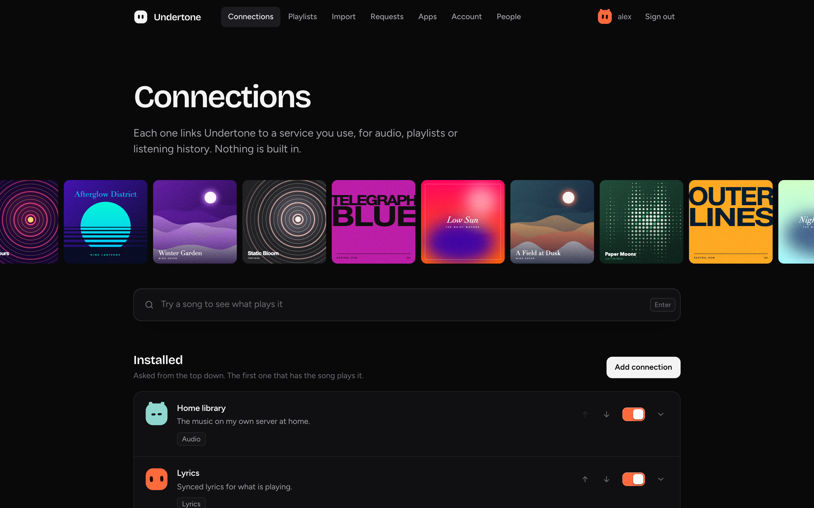
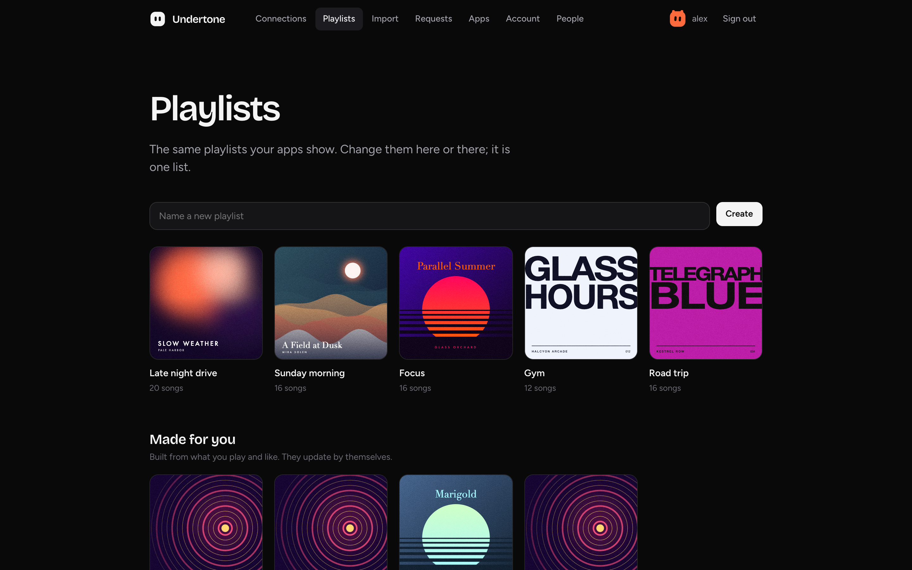
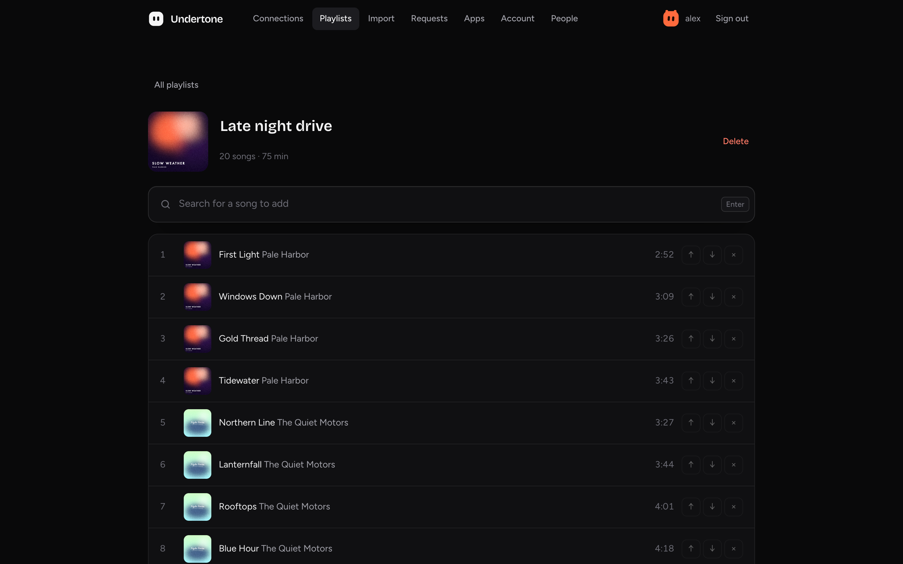
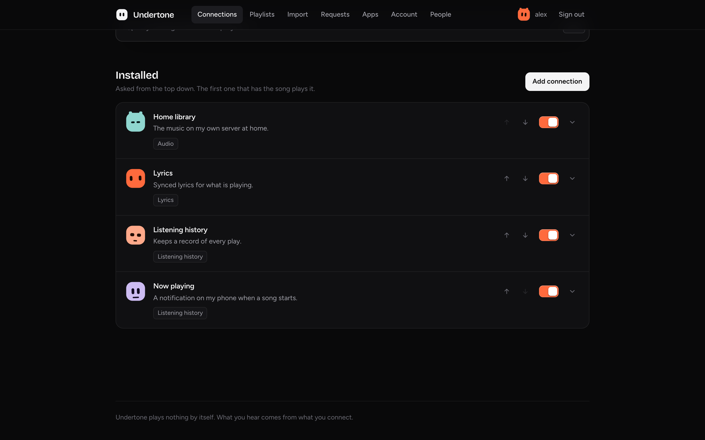

# Undertone

A small music server that speaks the Jellyfin API.



Undertone looks like a Jellyfin server to any Jellyfin music app. It has no catalog and no audio of its own. What it
can do is defined by **connections**: JSON files that describe how to talk to a service you use, such as your own
music server, a metadata catalog, a lyrics database or a listening-history tracker.

It is one Node process with one SQLite file, and ships as a Docker image.

|                                         |                                         |
| --------------------------------------- | --------------------------------------- |
|  |  |

- **Any Jellyfin music app.** Search, albums, artists, favorites, play counts, lyrics, instant mixes.
- **Playlists in both places.** Edit them on the web page or in the app; it is the same list. Lists made from what
  you play and like appear next to them.
- **Accounts.** Everyone has their own connections, library and playlists.
- **Import.** Paste a list of songs, a CSV or an M3U and get a playlist.
- **Nothing built in.** The server ships no sources. A catalog connection for names and cover art is included; the
  rest is yours to add.



## Run it

```bash
git clone https://github.com/OWNER/undertone.git
cd undertone
docker compose up -d
```

Open `http://<your-server>:8787` and create the first account. It becomes the admin.

Without Docker, `./start-local.sh` does the same with
Node.js 22.13 or newer.

## Connections

A connection is a single JSON file. People add one on the Connections page by pasting its link, uploading the file or
pasting its contents, then fill in whatever it asks for.

The server can also offer a list to pick from. Put connection files and an `index.json` in the `connections` folder
next to `docker-compose.yml`. The folder is mounted into the container, the files are served at `/connections/`, and
the list appears under "Available". The admin chooses the catalog from the same list, on the People page.

`index.json` looks like this:

```json
{
  "connections": [
    {
      "file": "my-server.json",
      "name": "My server",
      "description": "Music from my own server.",
      "does": ["audio"]
    }
  ]
}
```

The folder comes with one catalog connection, which is where names, track lists and cover art come from.

## Documentation

| Page                                       | For                                                                                         |
| ------------------------------------------ | ------------------------------------------------------------------------------------------- |
| [Getting started](docs/getting-started.md) | Running the server, accounts, the catalog, connections, apps, playlists, hosting for others |
| [How it works](docs/how-it-works.md)       | What happens when you search and when you press play                                        |
| [Writing connections](docs/connections.md) | The connection file format: every block and every field                                     |

## Settings

| Variable            | What it does                                                                                 | Default                                  |
| ------------------- | -------------------------------------------------------------------------------------------- | ---------------------------------------- |
| `PORT`              | Port to listen on                                                                            | `8787`                                   |
| `DATA_DIR`          | Where the database file lives                                                                | `/data` in the image, `./data` otherwise |
| `SERVER_NAME`       | Name shown to apps and on the setup page                                                     | `Undertone`                              |
| `SIGNUP`            | `open` lets anyone create an account from the start                                          | `closed`                                 |
| `CONNECTIONS_DIR`   | A folder of connection files to serve at `/connections/<file>.json`                          | `/app/connections` in the image          |
| `PRIVATE_NETWORK`   | Who may use connections that reach private or local addresses: `admin`, `everyone`, `nobody` | `admin`                                  |
| `TRUST_PROXY`       | `true` when a reverse proxy in front sets `X-Forwarded-For`                                  | off                                      |
| `CONNECTIONS_INDEX` | Link to a list of connections to offer, instead of the one in that folder                    | none                                     |
| `CATALOG`           | Link to a catalog connection file to start with, instead of letting the admin pick           | none                                     |

Everything the server remembers is in `undertone.db` inside the data volume. Back that file up; bring it along to move
servers. To update: `git pull && docker compose up -d --build`.

Put it behind a reverse proxy for HTTPS. The usual `X-Forwarded-Proto` and `X-Forwarded-Host` headers are honoured.

## Develop

```bash
npm install
npm run typecheck
npm run build
npm run format
```

No runtime dependencies: Node built-ins only.

## Layout

| Path                 | What it is                                                  |
| -------------------- | ----------------------------------------------------------- |
| `src/server.ts`      | HTTP server, SQLite storage, static `/connections/`         |
| `src/index.ts`       | Routing, authentication, CORS                               |
| `src/engine.ts`      | Runs connection files                                       |
| `src/connections.ts` | Each person's connections, and finding a stream for a track |
| `src/match.ts`       | Matching file names to tracks                               |
| `src/meta/`          | The catalog, read from a connection                         |
| `src/jellyfin/`      | The Jellyfin API                                            |
| `src/web/`           | The setup page and its API                                  |
| `schema.sql`         | Database tables                                             |
| `connections/`       | Connection files offered on this server                     |
| `docs/`              | Documentation                                               |

MIT licensed. The bundled fonts are under the SIL Open Font License (`src/web/fonts/LICENSE.txt`).

Undertone is an independent project. It is not affiliated with or endorsed by Jellyfin or by any service a connection
talks to. The album art in the screenshots is made up for the demo.
